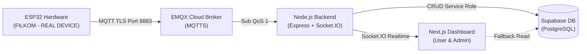

# 🚗 SmartCampus Parking — Sistem Monitoring Parkir Kampus Terpusat Berbasis IoT

Sistem monitoring ketersediaan lahan parkir dan kendali portal gerbang kampus secara *real-time* berbasis Internet of Things (IoT) dengan integrasi **ESP32**, **EMQX Cloud (MQTT Broker)**, **Node.js Backend**, **Supabase PostgreSQL**, dan **Next.js Dashboard**.

---

## 📐 Arsitektur Sistem



1. **ESP32 Node:** Membaca sensor jarak ultrasonik (HC-SR04), mendeteksi status slot kosong/terisi, dan mengendalikan servo portal barrier.
2. **EMQX Cloud:** Broker MQTT terpusat untuk komunikasi data aman over TLS (port 8883) dengan mekanisme Heartbeat dan Last Will and Testament (LWT).
3. **Node.js Backend (`server/`):** Subscriber MQTT, memvalidasi payload (Zod), mencatat riwayat aktivitas kendaraan, menyimpan data ke Supabase PostgreSQL, dan menyiarkan event *real-time* ke dashboard melalui Socket.IO.
4. **Supabase PostgreSQL:** Database relasional cloud penyimpan master data area, slot, gerbang, telemetri perangkat IoT, dan log riwayat aktivitas.
5. **Next.js Dashboard:** Antarmuka web modern responsif dengan pemantauan denah kampus 2D interaktif (*User Mode*) dan pusat kendali portal gerbang (*Admin Mode*).

---

## 📁 Struktur Direktori Proyek

```text
parking-dashboard/
├── app/                        # Halaman Frontend Next.js (App Router)
│   ├── page.tsx                # Portal Ketersediaan Mahasiswa / Pengunjung (User)
│   ├── admin/page.tsx          # Pusat Kendali & Operator IoT (Admin)
│   └── areas/[id]/page.tsx     # Detail Area Parkir & Denah Slot
├── components/                 # Komponen UI (Map, Cards, Status Badge, Charts)
│   ├── common/ConnectionStatusBar.tsx  # Bar Indikator Riil (MQTT, DB, ESP32)
│   └── map/CampusParkingMap.tsx        # Peta Kampus Interaktif 2D
├── context/
│   └── ParkingContext.tsx      # State management (Socket.IO + Supabase Realtime)
├── firmware/
│   └── esp32_smart_parking.ino # Source code Arduino C++ untuk mikrokontroler ESP32
├── server/                     # Backend Node.js + Express + TypeScript
│   ├── src/
│   │   ├── services/           # mqtt, parking, device, database, realtime
│   │   ├── controllers/        # REST API endpoints
│   │   └── index.ts            # Entry point server (Port 5000)
│   └── scripts/
│       ├── test_emqx.ts        # Script pengujian koneksi cepat ke EMQX
│       └── simulate_esp32.ts   # Simulator node fisik ESP32 FILKOM
├── supabase/
│   ├── schema.sql              # Skema awal database Supabase
│   └── migration_emqx.sql      # Skrip migrasi kolom data_source, distance_cm, dll.
├── .env.example                # Template konfigurasi environment
├── .env.local                  # Environment frontend Next.js
└── .env                        # Environment backend Node.js
```

---

## ⚙️ Prasyarat Sistem

Pastikan perangkat Anda telah terpasang:
* **Node.js** v18.x atau lebih baru (`node -v`)
* **npm** v9.x atau lebih baru (`npm -v`)
* Akun **[Supabase](https://supabase.com)** (gratis)
* Akun **[EMQX Cloud](https://cloud.emqx.com)** (Serverless gratis)
* *(Opsional)* **Arduino IDE** jika ingin mem-flash kode ke perangkat keras fisik ESP32.

---

## 🚀 Panduan Menjalankan Program

### Langkah 1: Klon & Instalasi Dependensi

Jalankan instalasi dependensi untuk Frontend dan Backend:

```bash
# 1. Instal dependensi frontend
npm install

# 2. Instal dependensi backend server
npm --prefix server install
```

---

### Langkah 2: Setup Database di Supabase

1. Buka proyek Supabase Anda di browser.
2. Masuk ke menu **SQL Editor**.
3. Jalankan skrip dasar dari file:
   [`supabase/schema.sql`](supabase/schema.sql)
4. Selanjutnya jalankan skrip migrasi EMQX dari file:
   [`supabase/migration_emqx.sql`](supabase/migration_emqx.sql)

---

### Langkah 3: Konfigurasi Environment Variables

Pastikan file konfigurasi `.env` (backend) dan `.env.local` (frontend) telah terisi:

**File `.env` (Backend):**
```ini
# EMQX Cloud MQTT Broker
MQTT_HOST=hc66ff31.ala.asia-southeast1.emqxsl.com
MQTT_PORT=8883
MQTT_USERNAME=nabath
MQTT_PASSWORD=nabath
MQTT_CLIENT_ID=smartcampus-backend-server

# Supabase Cloud Database
SUPABASE_URL=https://hcrwbttkqxipkbpojzcq.supabase.co
SUPABASE_SERVICE_ROLE_KEY=your_supabase_service_role_secret_key

# Server Port
PORT=5000
NODE_ENV=development
NEXT_PUBLIC_API_URL=http://localhost:5000
```

**File `.env.local` (Frontend Next.js):**
```ini
NEXT_PUBLIC_API_URL=http://localhost:5000
NEXT_PUBLIC_SUPABASE_URL=https://hcrwbttkqxipkbpojzcq.supabase.co
NEXT_PUBLIC_SUPABASE_ANON_KEY=sb_publishable_0drfCl7ALv3Y6wjKYrxQYQ_jsgUuelW
```

---

### Langkah 4: Uji Koneksi ke Broker EMQX Cloud

Sebelum menyalakan server, Anda dapat memverifikasi koneksi ke broker MQTT:

```bash
npm run test:emqx
```

*Jika berhasil, terminal akan menampilkan output `SUCCESS! Connected to EMQX Cloud Broker!`.*

---

### Langkah 5: Menjalankan Aplikasi

Buka **2 terminal terpisah**:

#### Terminal 1 — Jalankan Backend IoT Server:
```bash
npm run server
```
*Backend akan berjalan di port **5000** (`http://localhost:5000`), menyambung ke EMQX Broker, Supabase, dan membuka soket Socket.IO.*

#### Terminal 2 — Jalankan Frontend Dashboard:
```bash
npm run dev
```
*Buka browser di **[http://localhost:3000](http://localhost:3000)**.*

---

### Langkah 6: Menguji Pergerakan Sensor (Simulator ESP32)

Jika modul fisik ESP32 belum terpasang, jalankan simulator node hardware FILKOM pada terminal ketiga:

```bash
npm run simulate:esp32
```
Simulator ini akan:
1. Mengirim heartbeat node secara berkala (`ONLINE`).
2. Mengirim perubahan status deteksi sensor slot A1 dan A2 beserta jarak sensor ultrasonik (`distance_cm`).
3. Mendengarkan perintah kendali portal barrier gerbang dari dashboard dan mengembalikan konfirmasi aktual ke EMQX.

---

## 📡 Struktur Topik MQTT

| Arah Aliran | Topik MQTT | Keterangan Payload |
| :--- | :--- | :--- |
| **ESP32 $\rightarrow$ EMQX** | `campus/parking/{areaId}/node/status` | Heartbeat & status perangkat (`ONLINE` / `OFFLINE`, RSSI, Uptime) |
| **ESP32 $\rightarrow$ EMQX** | `campus/parking/{areaId}/slots/{slotId}` | Perubahan status slot (`AVAILABLE`, `OCCUPIED`, `distance_cm`) |
| **ESP32 $\rightarrow$ EMQX** | `campus/parking/{areaId}/gate/{gateId}/status` | Konfirmasi posisi fisik palang portal (`OPEN` 90° / `CLOSED` 0°) |
| **Backend $\rightarrow$ ESP32** | `campus/parking/{areaId}/gate/{gateId}/command` | Perintah buka/tutup portal dari Admin Dashboard |

---

## 🖥️ Panduan Penggunaan Dashboard

### 1. Mode Pengguna / Mahasiswa (`/`)
* **Connection Status Bar:** Menampilkan status nyata koneksi EMQX MQTT, Supabase DB, Node ESP32, dan timestamp data terakhir.
* **Campus Interactive Map:** Denah 2D kampus menampilkan status ketersediaan 4 gedung fakultas secara terpadu.
* **Filter & Pencarian:** Cari fakultas berdasarkan nama atau catatan operasional, dan filter menurut status ketersediaan.

### 2. Mode Pusat Kendali Admin (`/admin`)
* **Kendali Gerbang Barrier:** Tombol buka/tutup portal dengan proteksi konfirmasi fisik dua arah via MQTT.
* **Catatan Operasional Gerbang:** Form input catatan portal yang langsung tersinkron ke publik.
* **Override Status Slot:** Klik pada kartu slot mana saja untuk kalibrasi atau perubahan manual.
* **Log Riwayat Aktivitas & Ekspor CSV:** Audit trail kendaraan masuk/keluar lengkap dengan durasi parkir.

---

## 🛠️ Build untuk Produksi

```bash
# Build Backend Node.js
npm --prefix server run build

# Build Frontend Next.js
npm run build

# Menjalankan produksi
npm run start
```
